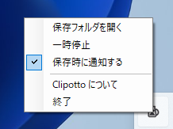

<p align="center">
  
</p>

<h1 align="center">Clipotto</h1>

<p align="center">
  クリップボードに入った画像を、自動でファイルに保存してくれる Windows 用の小さな常駐ツールです。
</p>

---

## 特長

- **コピーするだけで自動保存** — スクリーンショット（Win + Shift + S）や、ブラウザの「画像をコピー」など、クリップボードに画像が入るたびに PNG で保存します。
- **軽い** — Windows のクリップボード変更通知を使っているので、定期チェックのような無駄な処理がなく、CPU をほとんど使いません。
- **重複しない** — 同じ画像が続けてクリップボードに入っても、二重には保存しません。
- **タスクトレイに常駐** — 画面の邪魔にならず、右クリックメニューから操作できます。
- **ビルドが簡単** — Visual Studio は不要です。Windows に標準で入っている C# コンパイラでビルドできます。

## スクリーンショット



## 動作環境

- Windows 10 / 11
- .NET Framework 4.x（Windows 10 / 11 には標準で入っています）

## インストール

### ビルド済みの exe を使う

[Releases](../../releases) から `Clipotto.exe` をダウンロードして、好きな場所に置いて実行してください。インストール作業は必要ありません。

> **Note**
> 署名のない exe のため、初回起動時に Windows SmartScreen の警告が出ることがあります。その場合は「詳細情報」→「実行」で起動できます。

### ソースからビルドする

1. このリポジトリをクローン、または ZIP でダウンロードします。
2. `src` フォルダの中にある `build.bat` をダブルクリックします。
3. `src` フォルダに `Clipotto.exe` ができあがります。

`Clipotto.ico` が同じフォルダにあれば、アイコンが exe に埋め込まれます。ビルド後は ico ファイルがなくてもアイコンは表示されます。

<details>
<summary>コマンドで直接ビルドする場合</summary>

`src` フォルダで次のコマンドを実行します。

```bat
%WINDIR%\Microsoft.NET\Framework64\v4.0.30319\csc.exe ^
  /nologo /codepage:65001 /target:winexe /out:Clipotto.exe ^
  /r:System.Windows.Forms.dll /r:System.Drawing.dll ^
  /win32icon:Clipotto.ico /resource:Clipotto.ico,Clipotto.ico ^
  Clipotto.cs
```

</details>

## 使い方

`Clipotto.exe` を起動すると、タスクトレイにアイコンが表示されます。あとは画像をコピーするだけで、自動的に保存されます。

### 保存先

```
%USERPROFILE%\Pictures\Clipotto\
```

ファイル名は保存した日時になります（例: `20261116_153012_123.png`）。

### トレイメニュー

アイコンを右クリックすると、次のメニューが使えます。

| メニュー | 内容 |
| --- | --- |
| 保存フォルダを開く | 保存先フォルダをエクスプローラーで開きます（アイコンのダブルクリックでも開けます） |
| 一時停止 | 保存を一時的に止めます。もう一度選ぶと再開します |
| 保存時に通知する | 保存したときに通知を表示するかどうかを切り替えます |
| Clipotto について | バージョンとライセンス情報を表示します |
| 終了 | Clipotto を終了します |

### PC の起動時に自動で起動したい場合

1. Win + R を押して `shell:startup` と入力し、Enter を押します。
2. 開いたフォルダに `Clipotto.exe` のショートカットを置きます。

## 注意事項

- エクスプローラーで画像「ファイル」をコピーした場合は、クリップボードに入るのが画像データではなくファイルのパスなので、保存されません。
- コピー元のアプリによっては、透過情報が失われて背景が黒くなることがあります。
- Windows の「応答不可」（集中モード）がオンのときは、通知は画面に出ずに通知センターにだけ表示されます。
- 「一時停止」や「保存時に通知する」の設定は、アプリを終了すると元に戻ります。

## 更新履歴

### v1.0.0 — 2026-11-16

#### 追加

- 初回リリース

全履歴は [CHANGELOG.md](CHANGELOG.md) を参照。
